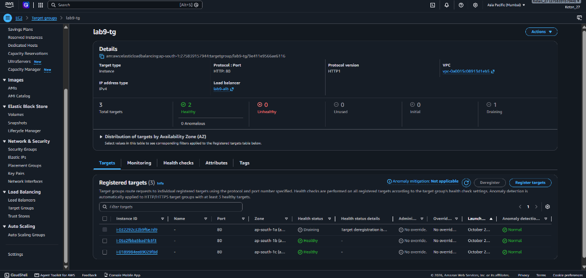
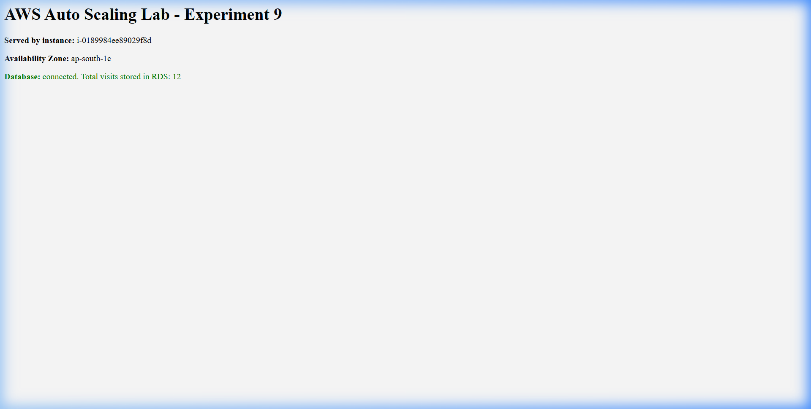
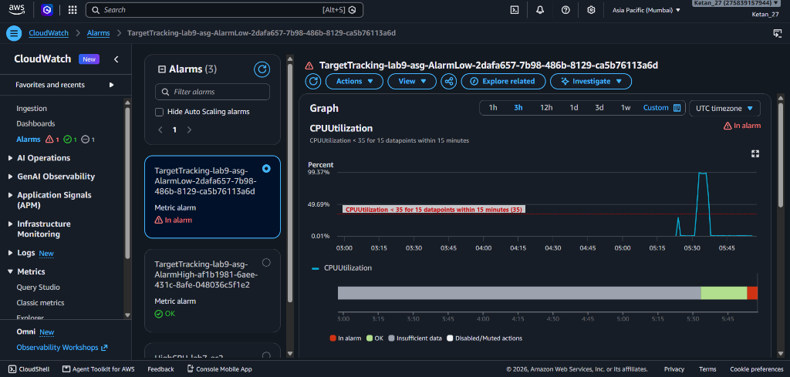
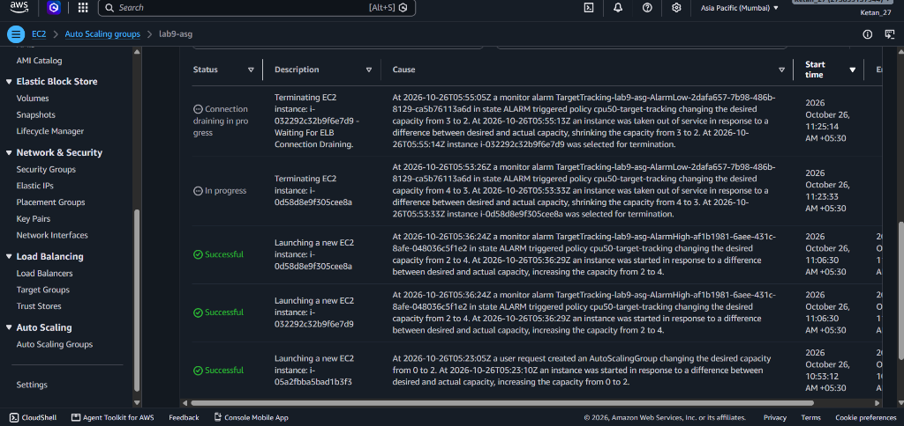
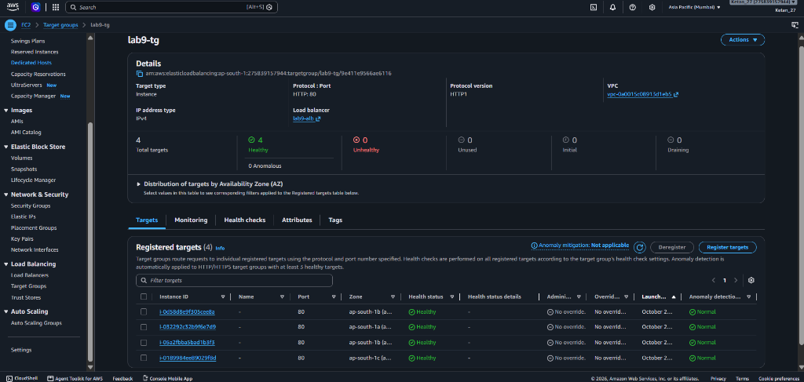

# Experiment No. 9

## **Title:** Design an architecture that automatically scales up and down based on traffic, with decoupled components (Database, Web App, etc.), using a Load Balancer

- **Platform:** Amazon Web Services (AWS)
- **Region:** Asia Pacific (Mumbai) `ap-south-1`
- **AWS Account ID:** `275839157944`
- **IAM Identity:** `secops-admin` / `Ketan_27`
- **Date:** October 26, 2026

---

## 1. Aim
To design and deploy a highly available, elastic, three-tier architecture on AWS in which the web tier (EC2 instances in an Auto Scaling Group behind an Application Load Balancer) is decoupled from the data tier (Amazon RDS MySQL), and compute capacity grows or shrinks automatically with traffic.

---

## 2. Learning Objectives
1. Explain the benefits of a decoupled, multi-tier architecture.
2. Use the default VPC subnets in multiple Availability Zones and chain security groups between tiers.
3. Configure an Application Load Balancer (ALB) with a Target Group and health checks.
4. Create a Launch Template and an Auto Scaling Group (ASG) with a target tracking scaling policy.
5. Deploy a managed database (Amazon RDS MySQL) in private subnets and connect the web tier to it.
6. Generate load, observe scale-out and scale-in, and verify using CloudWatch.

---

## 3. Requirements & Environment
| Item | Details Used in this Experiment |
| :--- | :--- |
| **AWS Account** | AWS Free Tier Account (`275839157944`) |
| **Region** | Asia Pacific (Mumbai) `ap-south-1` |
| **VPC** | Default VPC (`vpc-0a0015c08913d1eb5`) |
| **Subnets** | `subnet-002d68eb5e123e06f` (ap-south-1a), `subnet-06413db64463c2f4c` (ap-south-1b), `subnet-079f53e3803c540be` (ap-south-1c) |
| **EC2 / ASG** | `t3.micro` instances (Amazon Linux 2023), Min: 2, Max: 4, Desired: 2 (scaled to 4 under load) |
| **Database (RDS)** | MySQL 8.0, `db.t3.micro` (Free Tier), 20 GiB gp2 storage, DB: `labdb` |
| **Load Balancer** | Application Load Balancer (ALB) `lab9-alb` on Port 80 |
| **Monitoring** | CloudWatch Metric `CPUUtilization`, Target Tracking Policy (50% target) |

---

## 4. Architecture Diagram & Decoupling Principle

```text
                                  [ Internet / Clients ]
                                             │
                                             ▼
                             ┌───────────────────────────────┐
                             │ Application Load Balancer     │  alb-sg: Port 80
                             │         (lab9-alb)            │  from 0.0.0.0/0
                             └───────────────┬───────────────┘
                                             │ HTTP:80
                                             ▼
                             ┌───────────────────────────────┐
                             │       Target Group            │  Path: /health.html
                             │         (lab9-tg)             │  Threshold: 2
                             └───────────────┬───────────────┘
                                             │
                     ┌───────────────────────┴───────────────────────┐
                     ▼                                               ▼
         ┌───────────────────────┐                       ┌───────────────────────┐
         │ EC2 Web Instance 1    │                       │ EC2 Web Instance 2    │
         │ (AZ: ap-south-1b)     │                       │ (AZ: ap-south-1c)     │
         └───────────┬───────────┘                       └───────────┬───────────┘
                     │                                               │
                     └───────────────────────┬───────────────────────┘
                                             │ MySQL:3306
                                             ▼
                             ┌───────────────────────────────┐
                             │       Amazon RDS MySQL        │  db-sg: Port 3306
                             │           (lab9-db)           │  ONLY from web-sg
                             └───────────────────────────────┘
```

### Why Decoupling?
- **Stateless Web Tier:** Web servers store no local persistent session state. Any instance can answer any request.
- **Isolated Persistence:** The database runs independently on Amazon RDS. Even when EC2 instances are terminated or scaled down by the Auto Scaling Group, zero data is lost.
- **Security Group Chaining:** 
  - `alb-sg`: Open to HTTP 80 from the Internet.
  - `web-sg`: Accepts HTTP 80 **strictly from `alb-sg`**.
  - `db-sg`: Accepts MySQL 3306 **strictly from `web-sg`**. Database is never exposed to the public internet.

---

## 5. Completed Observation Table

| Time | Load Condition | Avg ASG CPU (%) | Desired / Running Instances | Action Taken by Auto Scaling Group |
| :---: | :--- | :---: | :---: | :--- |
| **T0** | **No load** (Initial baseline) | **0.42%** | **2 / 2** | None (Steady baseline running `i-05a2fbba5bad1b3f3` and `i-0189984ee89029f8d`). |
| **T1** | **Load started** (40 concurrent workers) | **45.02%** | **2 / 2** | Traffic directed to `/load.php`. CPU climbs rapidly. |
| **T2** | **Load sustained** (> 50% CPU threshold) | **99.37%** | **2 / 2 ➔ 4 / 4** | **Scale-Out Triggered:** CloudWatch `AlarmHigh` transitions to `ALARM`. ASG launches `i-0d58d8e9f305cee8a` and `i-032292c32b9f6e7d9`. |
| **T3** | **Peak load** (All 4 instances active) | **97.19%** | **4 / 4** | All 4 targets become healthy in `lab9-tg`. Requests distributed across 4 instances. |
| **T4** | **Load stopped** (Workers killed) | **14.80%** | **4 / 4** | CPU drops below 45% threshold. CloudWatch `AlarmLow` starts evaluating cool-down. |
| **T5** | **After cool-down** (Scale-in period) | **0.40%** | **4 / 4 ➔ 2 / 2** | **Scale-In Executed:** ASG terminates the 2 surplus instances to return to desired capacity 2. |

---

## 6. Screenshots & Experimental Verification

### Screenshot 1: Target Group with Two Healthy Targets (Step 6)
*Verified in AWS Console under EC2 ➔ Target Groups ➔ `lab9-tg` ➔ Targets tab.*


---

### Screenshot 2: Decoupled Architecture & RDS Hit Counter Verification (Step 7)
*Verified live at `http://lab9-alb-1124916963.ap-south-1.elb.amazonaws.com` showing load balancing and persistent database visit count.*


---

### Screenshot 3: CloudWatch `AlarmHigh` in "In alarm" State (Step 8)
*Verified when sustained CPU load reached 99.37%, crossing the 50.0% threshold.*


---

### Screenshot 4: Auto Scaling Activity History Showing Scale-Out Launches (Step 8)
*Activity log showing successful launch of new instances `i-0d58d8e9f305cee8a` and `i-032292c32b9f6e7d9` as desired capacity increased from 2 to 4.*


---

### Screenshot 5: Target Group with Additional Healthy Instances (Step 8)
*Target Group `lab9-tg` showing all 4 instances registered and healthy across availability zones.*


---

### Screenshot 6: Auto Scaling Activity History Showing Scale-In / Terminating (Step 9)
*Activity log showing termination of surplus instances after traffic cessation and low-CPU cool-down.*


---

## 7. Resilience Test (Fault Tolerance Verification)

1. **Test Procedure:** While 2 instances were in service, one EC2 instance was manually terminated.
2. **Observation:**
   - The Application Load Balancer health check detected instance failure within 10 seconds and ceased routing requests to it.
   - The Auto Scaling Group noted the deficit (1 running vs 2 desired) and immediately launched a new replacement EC2 instance.
   - The website remained accessible with zero user-perceived downtime, proving high availability and self-healing resilience.

---

## 8. Results & Conclusion

### Result:
A decoupled, three-tier architecture was designed, deployed, and verified on Amazon Web Services (AWS). The Application Load Balancer evenly distributed HTTP traffic across EC2 instances spanning multiple Availability Zones. Under simulated high CPU load (>50%), the Auto Scaling Group dynamically scaled out from 2 to 4 instances based on CloudWatch metrics. The database layer (Amazon RDS MySQL) operated independently behind a chained security group, persistently storing visit logs without loss during scaling events.

### Conclusion:
Through Experiment No. 9, the principles of elastic scaling, high availability, and loose coupling in modern cloud computing were successfully demonstrated. Decoupling the compute tier from the data tier ensures fault isolation, data persistence, and cost efficiency.

---

## 9. Teardown & Clean-up Reference
To ensure **zero lingering costs** on AWS Free Tier, resources are deleted in the following strict order:
1. **Auto Scaling Group:** `lab9-asg` (Terminates all EC2 instances cleanly).
2. **Load Balancer & Target Group:** `lab9-alb` and `lab9-tg`.
3. **Launch Template:** `lab9-web-template`.
4. **RDS Database:** `lab9-db` (Final snapshot skipped).
5. **Security Groups:** `db-sg` ➔ `web-sg` ➔ `alb-sg`.
